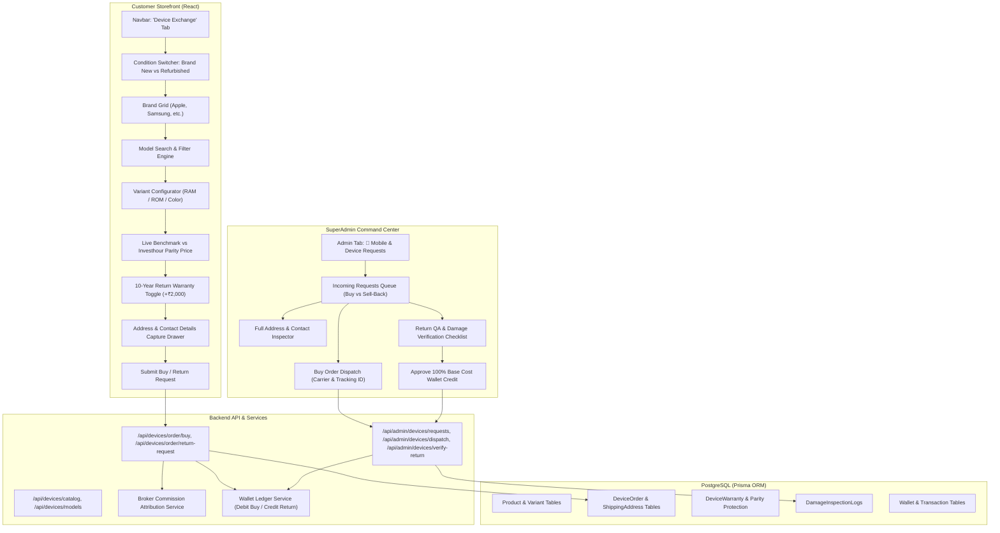
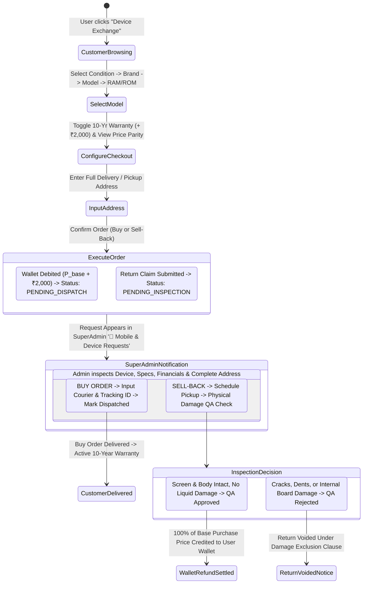
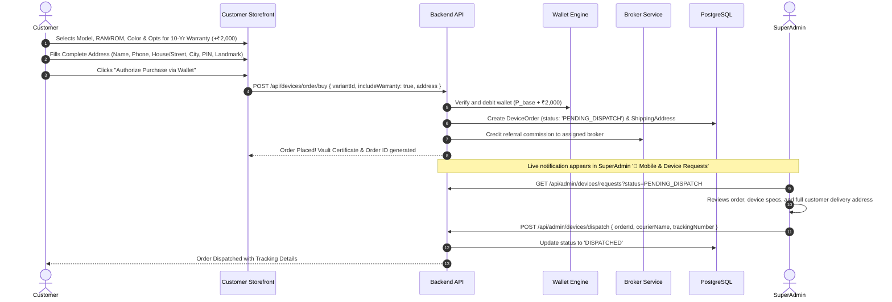
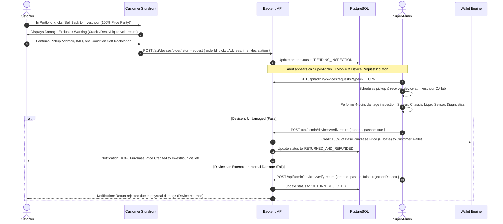
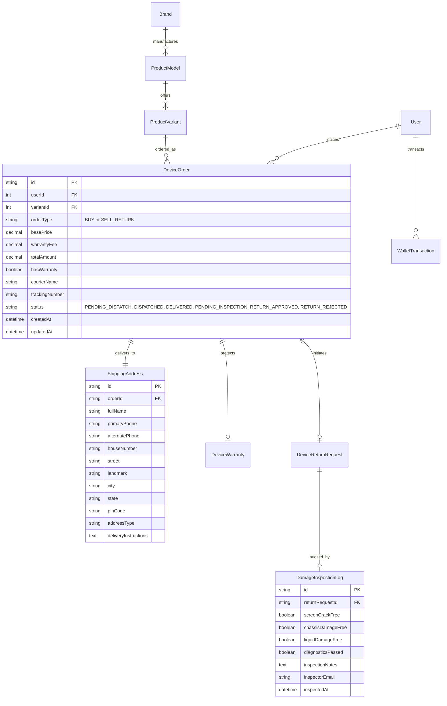
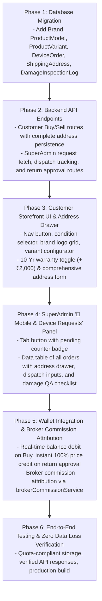

# Investhour Device & Gadget E-Commerce Exchange
## Comprehensive Architectural & UI/UX Implementation Plan

---

### Executive Summary

This implementation plan details the addition of a full-fledged **Device & Gadget E-Commerce Exchange** into the Investhour platform, complete with **SuperAdmin Order & Return Management**, **Full Address Collection**, and **Zero-Spread Price Parity with 10-Year Return Protection**:

1. **Identical Purchase & Sell-Back Base Price**: A user can purchase a product and later sell/return it to Investhour at the **exact same base cost** ($P_{return} = P_{base}$).
2. **10-Year Warranty & Parity Return Guarantee (+₹2,000)**: Users can opt for an extended 10-year protection guarantee for a flat ₹2,000 fee.
3. **Strict Physical Integrity Clause**: Returns at 100% price parity are strictly conditional on the device being in working, undamaged condition. **Any external physical damage (cracks, heavy dents, screen breaks) or internal physical/water damage voids the return parity guarantee**.
4. **Complete Customer Delivery / Pickup Address Capture**:
   - Every Buy and Sell request collects full address details (Full Name, Primary Mobile, Alternate Contact, House/Flat No, Street/Area, Landmark, City, State, PIN code, and Delivery/Pickup Instructions).
5. **Dedicated SuperAdmin Management Tab (`📱 Mobile & Device Requests`)**:
   - Live badge counter of pending requests.
   - Comprehensive real-time table of all incoming **BUY** and **SELL / RETURN** orders.
   - Full customer address inspection, courier tracking dispatch controls, and physical damage inspection verification checklist with one-click 100% wallet buyback payout approval.

---

### 1. Symbolic System Architecture



---

### 2. Complete End-to-End User & Admin State Machine



---

### 3. Detailed Buy & Sell Transaction Sequences

#### 3.1. Buy Order & Dispatch Flow with Complete Address Capture


#### 3.2. Sell-Back / Return Flow & SuperAdmin Damage Inspection


---

### 4. Complete Address & Contact Information Schema

Every Buy or Sell request captures the complete delivery/pickup details:

```json
{
  "shippingAddress": {
    "fullName": "Shiva Prasad",
    "primaryPhone": "9949215690",
    "alternatePhone": "9010672087",
    "email": "kshivaprasad33987@gmail.com",
    "houseNumber": "Plot 42, Flat 301, Sri Sai Residency",
    "street": "Road No. 12, Jubilee Hills",
    "landmark": "Near Apollo Hospital",
    "city": "Hyderabad",
    "state": "Telangana",
    "pinCode": "500033",
    "country": "India",
    "addressType": "Home",
    "deliveryInstructions": "Please call before arrival. Deliver between 10 AM - 6 PM."
  }
}
```

---

### 5. SuperAdmin Panel: "📱 Mobile & Device Requests" Specifications

#### 5.1. Navigation Button & Badge
- **Placement**: Directly in the SuperAdmin tab bar alongside *Client Watchlist*, *Broker Requests*, *Contest Leaderboard*, *Referral Program*, *Withdrawals*, and *Deposits*.
- **Style**:
  ```jsx
  <button
    type="button"
    onClick={() => setAdminTab('devices')}
    style={{
      background: adminTab === 'devices' ? '#f43f5e' : 'transparent',
      borderColor: adminTab === 'devices' ? '#f43f5e' : 'rgba(255,255,255,0.15)',
      ...
    }}
  >
    📱 Mobile & Device Requests
    {devicePendingCount > 0 && (
      <span className="badge-pending">{devicePendingCount}</span>
    )}
  </button>
  ```

#### 5.2. Admin Management Dashboard Layout

````carousel
```markdown
### View 1: Top Metrics & Real-Time Counters
- 📦 Total Orders Processed
- 🚚 Pending Dispatches (New Buys)
- 🔍 Pending Inspections (Sell-Back Returns)
- 🛡️ Total 10-Year Protected Devices
- 💰 Total Parity Buyback Volume Disbursed
```
<!-- slide -->
```markdown
### View 2: Filterable Orders Queue
- Filter Tabs: `All Requests` | `Buy Orders (Dispatch)` | `Sell-Back (Returns)` | `Completed / Closed`
- Search Bar: Search by Customer ID, Customer Name, Mobile Number, City, or Order ID
- Column Layout:
  1. Date & Time
  2. Order ID & Type Badge ([BUY] in Green, [SELL-BACK] in Amber)
  3. Customer Info: Name, Customer ID (e.g. CUST-84 / CUST-B-83), Phone, Email
  4. Device Details: Brand, Model, Condition (New/Refurbished), RAM/ROM, Color
  5. Financials: Base Price (₹), 10-Yr Warranty (₹2,000 / None), Total Paid
  6. Address & Contact: One-click "View Full Address" modal
  7. Status & Actions
```
<!-- slide -->
```markdown
### View 3: Expandable Address & Dispatch Drawer
- Full Address Breakdown:
  - Recipient: Full Name & Mobile Number
  - Destination: House/Flat, Street, Landmark, City, State, PIN
  - Instructions: Notes provided by the user
- Action Controls:
  - Input: Courier / Delivery Partner Name (e.g. BlueDart, DTDC, Investhour Logistics)
  - Input: Tracking ID / AWB Number
  - Button: "Confirm Dispatch & Notify Customer"
```
<!-- slide -->
```markdown
### View 4: QA Return Damage Verification Checklist
- Interactive Checklist:
  - [ ] External Chassis: Free of deep dents, edge impacts, or frame bends
  - [ ] Screen & Glass: 100% free of hairline/deep cracks or touch issues
  - [ ] Liquid Ingress: Internal Liquid Contact Indicators (LCI) white & untripped
  - [ ] Hardware Diagnostics: Motherboard, Cameras, WiFi, Biometrics fully functional
- Decision Buttons:
  - Green CTA: "Approve Return & Credit 100% Base Price to Wallet (₹P_base)"
  - Red CTA: "Reject Return (Physical Damage Found)" + Reason textarea
```
````

---

### 6. Database Entity Relationship Model (Updated)



---

### 7. Step-by-Step Implementation Roadmap



---

### 8. Architectural & Legal Guardrails

> [!IMPORTANT]
> **Complete Address Requirement**: Neither a Buy nor a Sell request can be finalized without a validated 6-digit Indian PIN code and 10-digit primary phone number, guaranteeing seamless logistics.

> [!WARNING]
> **Damage Return Exclusion Enforcement**:
> In the SuperAdmin QA panel, the "Approve 100% Refund" button is disabled until the inspector verifies all four physical integrity checkboxes (Screen, Chassis, Liquid, Diagnostics), ensuring no damaged devices are settled at full parity.
